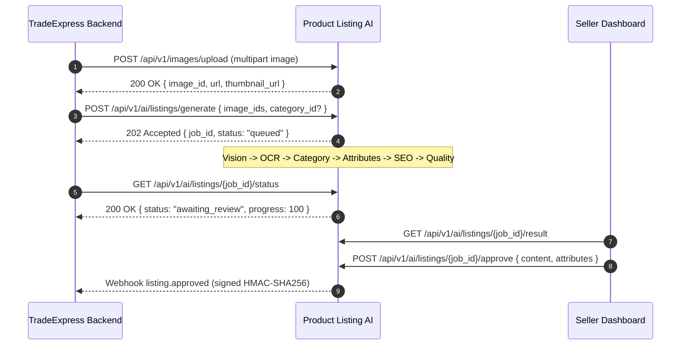

# Integration Guide — connecting TradeExpress to the Listing AI service

The AI service is an independent standalone platform: it never reads or writes the marketplace database directly. TradeExpress connects over REST with scoped API keys or user JWTs, and receives real-time event updates via HMAC-SHA256 signed webhooks.

Base path: `/api/v1`  
Interactive OpenAPI documentation: `GET /docs` (or `GET /openapi.json`)

---

## 1. Authentication Modes

### Mode A: Programmatic API Key (Recommended for TradeExpress Backend)
External servers and automated scripts authenticate using cryptographically secure API keys generated in the Developer Settings (`tx_live_...`):

```http
GET /api/v1/products
Host: listing-ai.tradeexpress.internal
X-API-Key: tx_live_9f81a7428f5a2b1c4e9d0a634582f1bc
```

- **Scoped Permissions:** API keys are bound to tenant organizations and grant granular scopes (`product:read`, `product:write`, `product:publish`, `offer:write`, `ai:run`).
- **Organization Context:** Injected automatically from the key's tenant ownership. `X-Organization-Id` is optional when using API keys.
- **Security:** Raw keys are hashed with SHA-256 before storage in PostgreSQL; keys can be revoked immediately from the Developer Settings dashboard.

### Mode B: User Session JWTs
For interactive user sessions, authenticate with email and password:

```http
POST /api/v1/auth/login
Content-Type: application/json

{"email": "seller@example.com", "password": "Sup3r-Secret-Password!"}
```
Response:
```json
{
  "access_token": "eyJhbGciOi...",
  "refresh_token": "def5020...",
  "expires_in": 900
}
```

- Send `Authorization: Bearer <access_token>` on requests.
- Send `X-Organization-Id: <uuid>` to select active organization.
- Refresh via `POST /api/v1/auth/refresh {"refresh_token": "..."}`. Refresh tokens automatically rotate with reuse detection.

---

## 2. Core Integration Workflows

### Workflow 1: AI Listing Ingestion & Review Pipeline



1. **Upload Images**: `POST /api/v1/images/upload` (multipart form `file`, PNG/JPEG/WebP, ≤10MB, ≥200×200px).
2. **Start Pipeline**: `POST /api/v1/ai/listings/generate` with `{"image_ids": ["<uuid>"], "category_id": null}`.
3. **Poll or Wait for Webhook**: `GET /api/v1/ai/listings/{job_id}/status`.
4. **Inspect Results**: `GET /api/v1/ai/listings/{job_id}/result` contains category mapping, extracted attributes with confidence scores and evidence, generated content, quality warnings, and OCR text.
5. **Seller Review & Approval**: `POST /api/v1/ai/listings/{job_id}/approve`. AI listings **never** publish without explicit seller approval.

---

### Workflow 2: Publishing to Master Catalog with Commercial Terms

Once a listing job is `approved`, convert it into a Master Catalog Product with verified attributes and seller commercial terms:

```http
POST /api/v1/products/from-job/c38df726-0e9b-4e89-8d5c-9c9489ef0d68
Content-Type: application/json
X-API-Key: tx_live_...

{
  "sku": "TX-PROD-HEADPHONES-01",
  "offer_type": "both",
  "retail_price": 79.99,
  "wholesale_price": 45.00,
  "currency": "USD",
  "min_order_quantity": 5,
  "lead_time_days": 3,
  "stock_quantity": 250
}
```

Response (`201 Created`):
```json
{
  "id": "e2a1b940-523c-41c8-bb83-16279fcf151a",
  "title": "ACME Active Noise Cancelling Wireless Headphones",
  "brand": "ACME",
  "model": "ANC-200",
  "status": "published",
  "variants": [
    {
      "id": "f48c12a0-9c1a-4f51-b01b-91283c748291",
      "sku": "TX-PROD-HEADPHONES-01",
      "variant_name": "Standard Edition",
      "is_active": true
    }
  ],
  "attributes": [
    {
      "attribute_key": "connectivity",
      "value": "Bluetooth 5.3",
      "confidence": 0.96,
      "source": "image",
      "verified": true
    }
  ]
}
```

---

### Workflow 3: Duplicate & Similarity Detection

Before creating new listings, check for duplicate items using perceptual dHash, exact SHA-256 image match, brand/model correlation, and text similarity:

```http
POST /api/v1/ai/duplicates/check
Content-Type: application/json
X-API-Key: tx_live_...

{
  "title": "Wireless Bluetooth Over-Ear Headphones",
  "brand": "ACME",
  "model": "ANC-200",
  "image_ids": ["c4a30e84-18c2-4112-a894-c15c89838d12"]
}
```

Response:
```json
[
  {
    "product_id": "e2a1b940-523c-41c8-bb83-16279fcf151a",
    "title": "ACME Active Noise Cancelling Wireless Headphones",
    "match_type": "exact_image_match",
    "confidence": 1.0,
    "reason": "Exact image hash match with existing catalog item."
  }
]
```

---

### Workflow 4: International Regulatory Compliance Advisory

Verify product attributes and marketing claims against destination market standards (EU, US, GCC, India):

```http
POST /api/v1/compliance/check
Content-Type: application/json
X-API-Key: tx_live_...

{
  "market_code": "EU",
  "category_slug": "electronics",
  "attributes": {
    "wireless": true,
    "voltage": "220V"
  },
  "text_content": "Premium wireless headphones with ultra-long battery life."
}
```

Response:
```json
{
  "market_code": "EU",
  "is_compliant": false,
  "violations": [],
  "advisories": [
    {
      "rule": "EU_CE_ROHS",
      "reason": "Electronic product entering EU market requires CE conformity and RoHS declaration.",
      "action_required": "Provide EU Declaration of Conformity and RoHS compliance statement."
    },
    {
      "rule": "EU_WEEE",
      "reason": "Electrical equipment requires WEEE crossed-out wheelie bin marking.",
      "action_required": "Ensure packaging displays WEEE symbol and register with national EPR authority."
    }
  ]
}
```

---

## 3. Webhook Integration & Signature Verification

TradeExpress AI delivers signed HTTPS POST requests for subscribed event topics:

- `listing.approved`: Triggered when seller reviews and accepts AI listing.
- `product.published`: Triggered when a product transitions to live catalog status.

### Webhook Headers
```http
POST /api/v1/webhooks/tx-ai HTTP/1.1
Host: tradeexpress-1.onrender.com
Content-Type: application/json
X-TradeExpress-Signature: t=1730626800,v1=5d41402abc4b2a76b9719d911017c592...
X-TradeExpress-Event: listing.approved
```

### Signature Verification Algorithm
Each payload is signed using HMAC-SHA256 with the endpoint secret (prefix `whsec_...`):

1. Split `X-TradeExpress-Signature` into timestamp `t` and signature `v1`.
2. Construct the signed string: `${t}.${raw_request_body}`.
3. Compute `hmac_sha256(endpoint_secret, signed_string)`.
4. Compare hex digests using constant-time string comparison (`hmac.compare_digest` / `crypto.timingSafeEqual`).
5. Reject requests older than 300 seconds to prevent replay attacks.

#### Python Verification Example:
```python
import hmac
import hashlib
import time

def verify_tradeexpress_webhook(raw_body: bytes, sig_header: str, secret: str) -> bool:
    pairs = dict(item.split("=", 1) for item in sig_header.split(","))
    timestamp = int(pairs["t"])
    expected_v1 = pairs["v1"]

    # Prevent replay attacks (> 5 minutes old)
    if abs(time.time() - timestamp) > 300:
        return False

    to_sign = f"{timestamp}.".encode("utf-8") + raw_body
    computed_sig = hmac.new(secret.encode("utf-8"), to_sign, hashlib.sha256).hexdigest()
    return hmac.compare_digest(computed_sig, expected_v1)
```

#### Node.js Verification Example:
```typescript
import crypto from "node:crypto";

export function verifyWebhook(rawBody: string | Buffer, sigHeader: string, secret: string): boolean {
  const parts = Object.fromEntries(sigHeader.split(",").map(part => part.split("=")));
  const timestamp = parseInt(parts.t, 10);
  const signature = parts.v1;

  if (Math.abs(Date.now() / 1000 - timestamp) > 300) {
    return false;
  }

  const payload = `${timestamp}.${typeof rawBody === "string" ? rawBody : rawBody.toString("utf8")}`;
  const computed = crypto.createHmac("sha256", secret).update(payload).digest("hex");
  return crypto.timingSafeEqual(Buffer.from(computed), Buffer.from(signature));
}
```

---

## 4. Idempotency Support

For safe retries of state-changing operations (such as product creation or publishing from jobs), provide a unique UUID in the `Idempotency-Key` header:

```http
POST /api/v1/products/from-job/<job_id>
Idempotency-Key: 7b817c18-9182-411a-bc01-e737190f8482
```

- If an operation with the same key is already in progress, the API returns `409 Conflict`.
- Once completed, identical repeated requests return the cached response with `X-Cache-Lookup: HIT`.

---

## 5. Standard Error Envelope

All error responses strictly adhere to the unified JSON error format:

```json
{
  "error": {
    "code": "validation_error",
    "message": "Listing validation failed",
    "details": {
      "retail_price": ["Price must be greater than zero"]
    }
  }
}
```

Standard Error Codes:
- `401 unauthorized`: Invalid or missing credentials / API key.
- `403 forbidden`: Insufficient permissions or wrong tenant context.
- `404 not_found`: Entity does not exist or belongs to another organization.
- `409 conflict`: Concurrency violation or duplicate idempotency operation.
- `422 validation_error`: Pydantic schema or category attribute rule violation.
- `429 rate_limited`: Request quota exceeded; retry using `Retry-After` header.
- `503 ai_provider_unavailable`: AI model capacity or upstream outage; backoff and retry.
